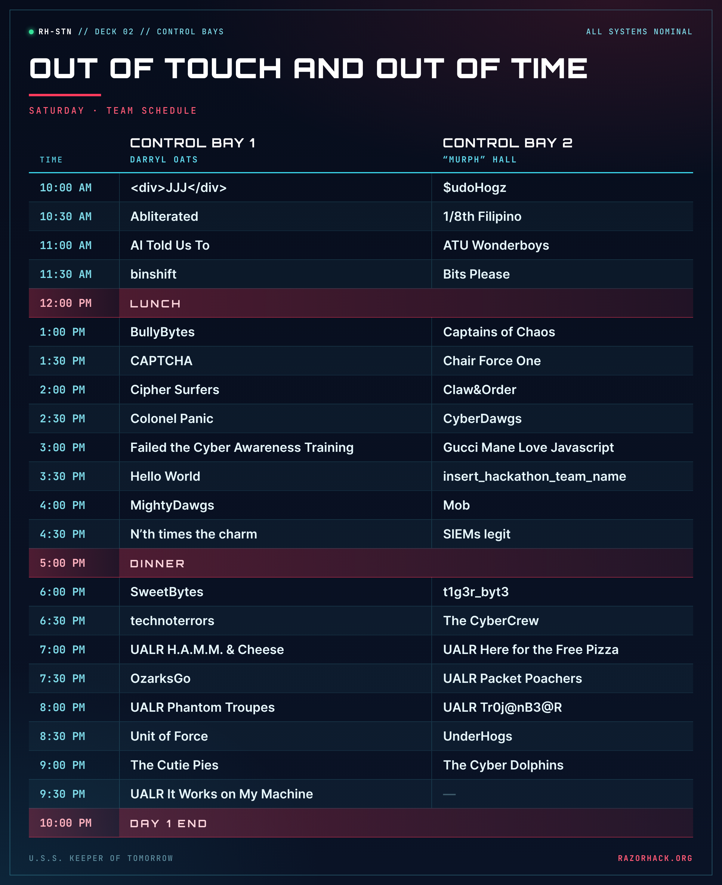

# Out of Touch and Out of Time by Hall & Oats

**Category:** VR Control Room  **Value:** 2000  **Author:** Murphy "Murph" Hall & Darryl Oats

## Description

Come see Hall & Oats at your scheduled time.

## How it runs

In person: each team comes to the VR control room at its scheduled time and clears up to four
VR challenges with Hall & Oats, 500 points each (2000 in all). There is no flag to submit: Hall &
Oats add the team's points in CTFd. Nothing to download and nothing to host.
